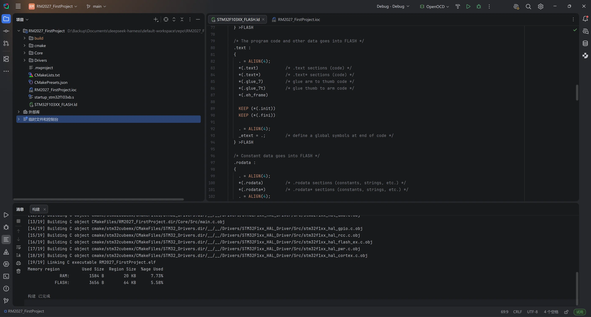

# 电控组首次培训作业

- **王语清**
- ***20263001319***

## 项目简介

RoboMaster 电控组首次培训作业：使用 STM32CubeMX 创建 STM32F103C8T6 工程，工具链为 CMake + arm-none-eabi-gcc，在 CLion 中编译通过。

| 项目 | 说明 |
| --- | --- |
| MCU | STM32F103C8T6（LQFP48，64 KB Flash / 20 KB RAM） |
| 系统时钟 | HSE 8 MHz → PLL ×9 → SYSCLK 72 MHz；APB1 36 MHz，APB2 72 MHz |
| 调试接口 | Serial Wire（SWD） |
| 生成工具 | STM32CubeMX 6.15.0，STM32Cube FW_F1 V1.8.7 |
| 编译环境 | CLion 2026.2.2 + CMake + Ninja + arm-none-eabi-gcc |

## 编译结果

Debug 配置编译通过（19/19 个编译、链接步骤），内存占用：

| 区域 | 已用 | 容量 | 占比 |
| --- | --- | --- | --- |
| RAM | 1584 B | 20 KB | 7.73% |
| FLASH | 3656 B | 64 KB | 5.58% |



## 目录结构

```text
.
├── README.md
├── docs/
│   └── build-success.png        # 编译成功截图
└── RM2027_FirstProject/
    ├── RM2027_FirstProject.ioc  # CubeMX 工程配置
    ├── CMakeLists.txt
    ├── CMakePresets.json
    ├── Core/                    # 应用代码（main.c 等）
    ├── Drivers/                 # HAL 库与 CMSIS
    ├── cmake/                   # 交叉编译工具链配置
    ├── startup_stm32f103xb.s
    └── STM32F103XX_FLASH.ld
```

## 编译方法

先确保 `arm-none-eabi-gcc` 已加入 PATH（配置方法见《南海鲨开发环境配置文档》），然后执行：

```bash
cd RM2027_FirstProject
cmake --preset Debug
cmake --build --preset Debug
```

也可以在 CLion 中打开 `RM2027_FirstProject` 目录，选择 `Debug` 预设直接构建。
